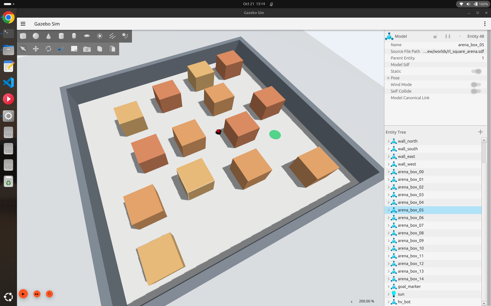
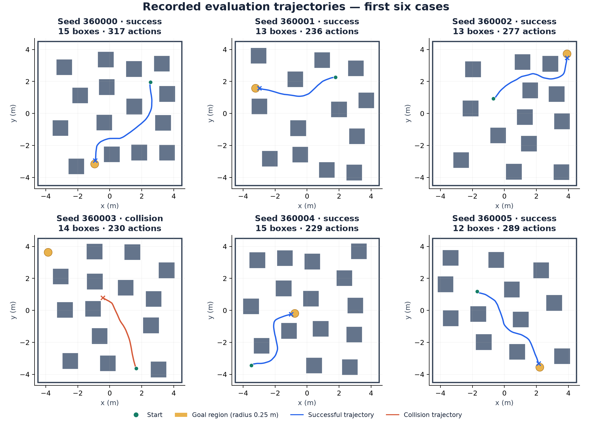
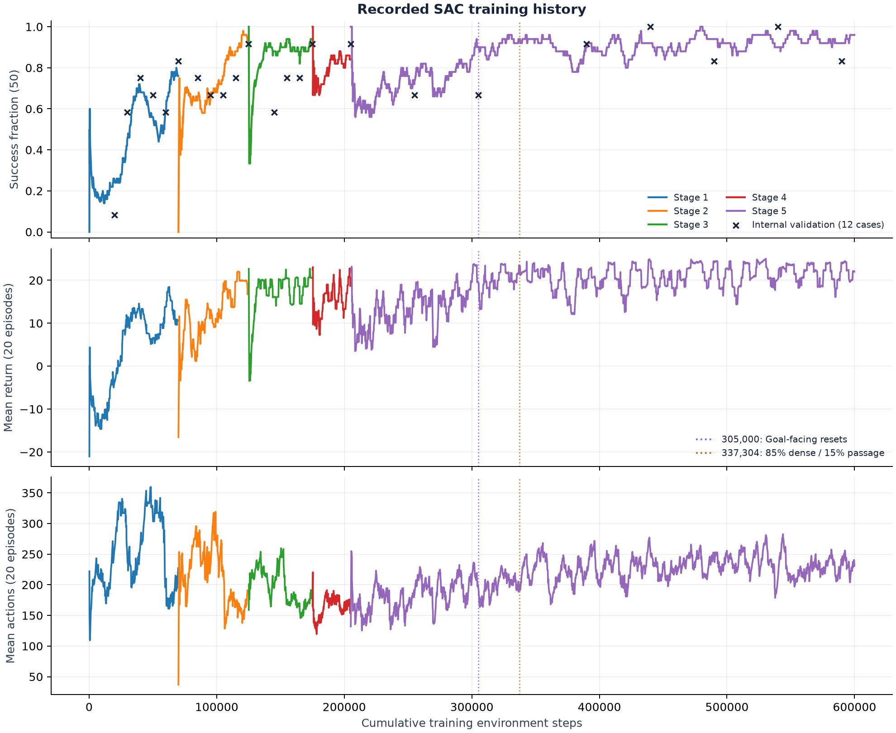
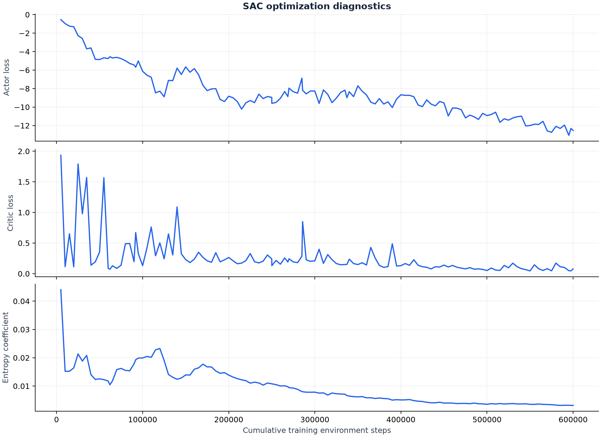
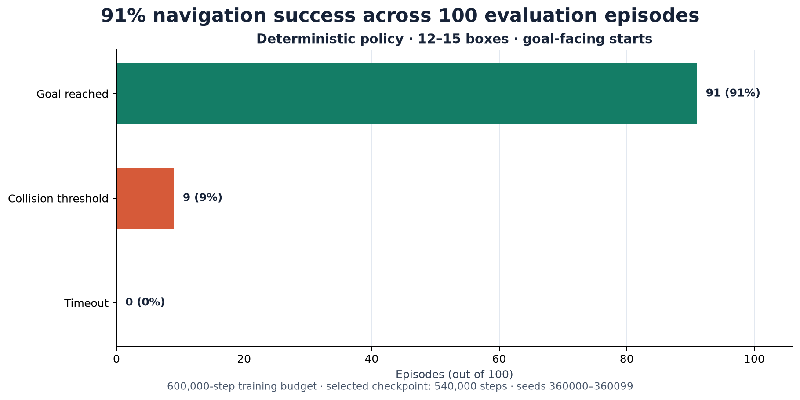
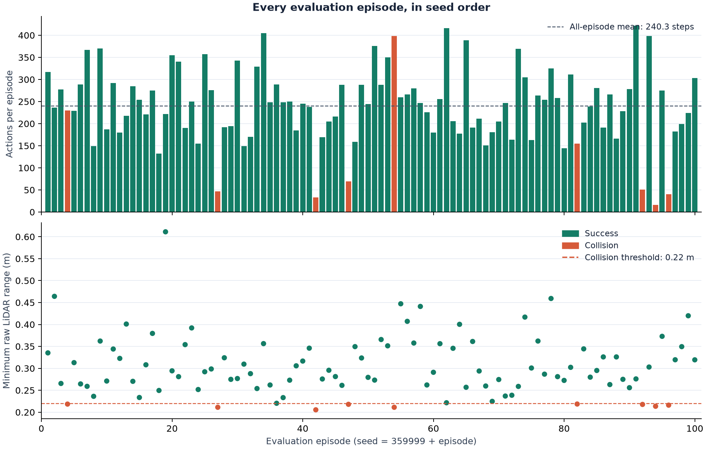

# SAC LiDAR Navigation with ROS 2

**ROS 2 Jazzy · Gazebo Harmonic · Stable-Baselines3 · PyTorch**

A differential-drive robot learns to reach randomly placed goals among static obstacles using Soft Actor-Critic (SAC). A separate deterministic evaluation recorded **91 successes, 9 collisions and no timeouts across 100 dense layouts**.

The experiment used a **600,000-step training budget**. The published policy is the **540,000-step checkpoint**, selected by internal validation before the final evaluation. Starts face the goal; forward speed is fixed at **0.22 m/s**.

## Environment and navigation



*Gazebo screenshot of the robot and its 9 × 9 m arena.*



*Reconstruction from the first six evaluation layouts and recorded trajectories, including the collision in seed 360003. This is a data visualization.*

| Item | Implementation |
|---|---|
| Observations | 20 minimum-pooled LiDAR sectors over 360° and two relative goal offsets in the robot frame: **22 values** |
| Action | One continuous steering command, mapped to **−1.2 to +1.2 rad/s** |
| Forward motion | Fixed **0.22 m/s**; one action advances **0.1 simulated seconds** |
| Policy | Feedforward MLP with two 256-unit layers; SAC with twin critics and replay |
| Dense task | Random start, goal and positions of **12–15 boxes**, each 1 × 1 m |
| Initialization | Robot starts facing the goal, subject to simulator settling tolerance |
| Goal / collision | Goal distance ≤0.25 m / minimum raw LiDAR range ≤0.22 m |

The policy chooses steering directly from LiDAR and the relative goal. Obstacle coordinates, reference routes and waypoints are not actor inputs. Known simulator geometry is used to generate reachable tasks and calculate a detour-distance **training reward**. This is a simulation experiment with static obstacles.

## Training process

| Stage | Practice |
|---|---|
| 1 | Short goals with 0–1 boxes |
| 2 | Detours with 1–3 boxes |
| 3 | Wider two-box passages, with 0.9–1.3 m gaps |
| 4 | Narrower passages, with 0.65–0.95 m gaps, and mixed obstacle tasks |
| 5 | Dense layouts; the final sampling profile uses 85% dense tasks and 15% passage practice |

Promotion requires at least **10/12 deterministic validation successes**, after the stage's minimum training budget. Validation runs every 10,000 steps in earlier stages and every 50,000 in the dense stage. Two internal seed banks alternate. They are development cases, separate from the final 100-case bank.

The historical run began with seed-42 weights and the original heading distribution. At **305,000 steps**, it continued with goal-facing resets. Later, stage-5 sampling changed to the dense/passage mixture shown above. Weights, optimizers and valid replay transitions were retained during these distribution changes. Starting fresh with today's configuration is a **new experiment** and does not repeat this historical sequence exactly.

The reward combines potential-based progress shaping, +20 for reaching the goal, −20 for collision, a step cost, obstacle-proximity costs and a stuck cost. SAC uses learning rate `0.0003`, replay capacity `200000`, batch size `256`, discount `0.998`, target update factor `0.005` and automatic entropy tuning. Timeouts are truncations and retain value bootstrapping.



*Curves come from retained training CSVs; the data manifest records their coverage. Training success uses rolling windows of 50 episodes; returns and lengths use 20. Markers identify changes to initialization and sampling.*



*Optimization diagnostics from saved update records. These are separate from navigation success on the evaluation cases.*

## Evaluation results

The frozen 540,000-step policy was evaluated deterministically on seeds **360000–360099**, with 12–15 boxes per layout, goal-facing initialization and a 1,600-action episode limit. All 100 episodes are included.

| Outcome | Episodes | Rate |
|---|---:|---:|
| Goal reached | 91 | **91%** |
| Collision threshold reached | 9 | 9% |
| Timeout | 0 | 0% |

Mean episode length was **240.3 actions** across all outcomes. Ninety-nine layouts had a blocked direct start-to-goal line, and the robot succeeded in 90 of those. The collision label comes from the LiDAR distance threshold; it is not a contact-sensor measurement. The 91% result applies to this model, simulator and seed bank.





Corner clearance and close obstacle approaches remain limitations. Further training and refinement **may** improve reliability; a higher success rate needs another measured evaluation. Moving obstacles and real-robot transfer have not been validated.

## Install and build

Use **Ubuntu 24.04, ROS 2 Jazzy, Gazebo Harmonic and Python 3.12**. If ROS is not installed, prepare its official apt repository first:

```bash
sudo apt update
sudo apt install -y curl software-properties-common
sudo add-apt-repository -y universe
export ROS_APT_SOURCE_VERSION="$(curl -fsSL https://api.github.com/repos/ros-infrastructure/ros-apt-source/releases/latest | python3 -c 'import json,sys; print(json.load(sys.stdin)["tag_name"])')"
export ROS_UBUNTU_CODENAME="$(. /etc/os-release; printf '%s' "${UBUNTU_CODENAME:-$VERSION_CODENAME}")"
curl -fL -o /tmp/ros2-apt-source.deb "https://github.com/ros-infrastructure/ros-apt-source/releases/download/${ROS_APT_SOURCE_VERSION}/ros2-apt-source_${ROS_APT_SOURCE_VERSION}.${ROS_UBUNTU_CODENAME}_all.deb"
sudo dpkg -i /tmp/ros2-apt-source.deb
sudo apt update
sudo apt install -y ros-jazzy-desktop
```

Install workspace dependencies, clone and build:

```bash
sudo apt install -y git python3-venv python3-pip python3-rosdep \
  python3-colcon-common-extensions ros-jazzy-ros-gz ros-jazzy-xacro \
  ros-jazzy-robot-state-publisher ros-jazzy-rviz2
mkdir -p ~/projects
cd ~/projects
git clone https://github.com/Harivathsha/ros2-sac-lidar-navigation.git
cd ros2-sac-lidar-navigation
source /opt/ros/jazzy/setup.bash
python3 -m venv --system-site-packages .venv
touch .venv/COLCON_IGNORE
source .venv/bin/activate
python -m pip install --upgrade pip
python -m pip install 'torch>=2.3,<3' --index-url https://download.pytorch.org/whl/cpu
python tools/install_sac_dependencies.py
if [ ! -f /etc/ros/rosdep/sources.list.d/20-default.list ]; then
  sudo rosdep init
fi
rosdep update
rosdep install --from-paths src --ignore-src --rosdistro jazzy -r -y
colcon build --symlink-install --packages-select description_new nav_learning
source install/setup.bash
python -m nav_learning.check_sac --offline --device cpu
```

This installs CPU PyTorch. On the author's existing CUDA laptop, use the working `~/ai_envs/robotics_ai` environment and keep its PyTorch installation. Set `SAC_DEVICE=cuda` only when `python -c 'import torch; print(torch.cuda.is_available())'` reports `True`. The dependency installer preserves the installed Torch/NumPy builds.

## Launch and test the published policy

Prepare **each terminal** from the repository root:

```bash
source /opt/ros/jazzy/setup.bash
source .venv/bin/activate
source install/setup.bash
export SAC_DEVICE=cpu
```

Terminal 1 — keep Gazebo running:

```bash
ros2 launch description_new launch_sim.launch.py
```

Terminal 2 — optional live setup check, then the saved model:

```bash
python -u -m nav_learning.check_sac --device "$SAC_DEVICE"
python -u -m nav_learning.evaluate_sac \
  --run-dir models/sac_dense_540k --checkpoint best \
  --stage 4 --suite standard --episodes 100 --seed-base 360000 \
  --output-dir "runs/published_evaluation_$(date +%Y%m%d_%H%M%S)" \
  --device "$SAC_DEVICE"
```

For a short demonstration, use `--episodes 3` and a separate output directory. Reported 91/100 results belong to the full evaluation. Physics pauses between controlled actions and during updates. Run one learner or evaluator at a time. Simulator timing can cause small differences on another machine.

## Fresh training and resume

This starts at **step zero with new weights and an empty replay buffer**, using the current goal-facing curriculum:

```bash
mkdir -p runs/sac
export SAC_RUN="$PWD/runs/sac/recording_$(date +%Y%m%d_%H%M%S)"
printf '%s\n' "$SAC_RUN" > runs/sac/recording_run_path.txt
time python -u -X faulthandler -m nav_learning.train_sac \
  --config src/nav_learning/config/sac_training.yaml \
  --run-dir "$SAC_RUN" --target-steps 600000 --device "$SAC_DEVICE"
```

Press **Ctrl+C once** and wait for the saved-step message before closing the terminal. To resume this fresh run:

```bash
export SAC_RUN="$(cat runs/sac/recording_run_path.txt)"
python -u -X faulthandler -m nav_learning.train_sac \
  --resume "$SAC_RUN" --target-steps 600000 --device "$SAC_DEVICE"
```

The target is absolute. Full checkpoints include model/optimizer state, replay, random-generator states and curriculum progress; the physical episode resets on resume. The two latest checkpoint step counts are retained. The published best policy is an evaluation artifact; new runs save their own full resume checkpoints.

After training, evaluate the run's internally selected best dense policy:

```bash
export SAC_EVAL_DIR="$SAC_RUN/evaluation_$(date +%Y%m%d_%H%M%S)"
python -u -m nav_learning.evaluate_sac \
  --run-dir "$SAC_RUN" --checkpoint best \
  --stage 4 --suite standard --episodes 100 --seed-base 460000 \
  --output-dir "$SAC_EVAL_DIR" --device "$SAC_DEVICE"
python -m nav_learning.plot_sac_results \
  --run-dir "$SAC_RUN" --evaluation-dir "$SAC_EVAL_DIR"
```

The final command requires a saved stage-5 best policy. Earlier-stage checks use `--suite curriculum` and the matching zero-based `--stage 0`–`3`. New run scores are measured separately from the published 91% result.

## Recreate figures and check the software

These commands need no running simulator:

```bash
python -m pytest -q src/nav_learning/test
python tools/plot_sac_release.py \
  --evaluation-dir docs/results/evaluation_100 \
  --training-dir docs/results/training \
  --provenance docs/results/provenance/training_provenance.json \
  --model models/sac_dense_540k/best/stage_04/model.zip \
  --output-dir docs/plots
```

| Path | Contents |
|---|---|
| `src/description_new/` | Robot, arena, launch files and ROS/Gazebo bridges |
| `src/nav_learning/` | Environment, SAC training, evaluation, configuration and tests |
| `models/sac_dense_540k/` | Exact tested model, frozen configuration and selection metadata |
| `docs/results/` | All 100 evaluation records, recorded training CSVs and experiment provenance |
| `docs/images/`, `docs/plots/` | Gazebo photo and figures recreated from recorded data |
| `runs/` | Local outputs of new training and evaluation; excluded from Git |

If packages cannot be found, build from the workspace root and source `install/setup.bash`. If `rclpy` cannot import, source Jazzy and use Python 3.12 with system site packages. If startup waits for sensors, check `/scan`, `/odom`, `/clock` and the simulator launch terminal.

The Isaac SAC reference informed the steering-only experiment design. The learner here uses maintained Stable-Baselines3 SAC and a feedforward policy; this is an adaptation to this robot and environment.

**Author:** Harivathsha · **License:** Apache-2.0
